# Mapa de infraestructura peatonal: Mercedes Norte

Mapa colaborativo que muestra cómo está la infraestructura para caminar en el barrio Mercedes Norte: aceras, cruces, paradas de bus, parques e hidrantes. Los datos se recogen caminando con el celular y se publican automáticamente en un mapa web.

### [Ver el mapa](https://jotardgz06.github.io/Mapeo_tematico/)

Proyecto del curso Sistemas de Información Geográfica (Instituto Tecnológico de Costa Rica, II Semestre 2026). Integrantes: José Julián Rodríguez Chaves, Pablo Fuentes y Emanuel Antonio Garro Alvarado.

## Guía de mapeo

**Contenido**

1. [¿Qué es este mapa y para qué sirve?](#1-qué-es-este-mapa-y-para-qué-sirve)
2. [Descargar la disposición de botones en OSMTracker](#2-descargar-la-disposición-de-botones-en-osmtracker)
3. [Mapear en el campo](#3-mapear-en-el-campo)
4. [Subir las trazas al repositorio](#4-subir-las-trazas-al-repositorio)
5. [Consultar el mapa](#5-consultar-el-mapa)
6. [Enlaces del proyecto](#6-enlaces-del-proyecto)

---

## 1. ¿Qué es este mapa y para qué sirve?

Un mapa temático no muestra todo lo que hay en un lugar, sino que se centra en un tema. Aquí el tema es la **infraestructura peatonal**: cómo se camina de verdad por Mercedes Norte. El mapa reúne lo que influye en quien va a pie: aceras (y los tramos donde se interrumpen), pasos peatonales, semáforos, señales de tránsito, reductores de velocidad, hidrantes, parques, canchas y paradas de bus.

Toda la información se recoge en el campo con la aplicación **OSMTracker**: en cada recorrido se guarda el camino con el GPS, se marca cada elemento según su tipo y se toman fotos como evidencia. Después, el proceso es automático: al subir un recorrido, el mapa se actualiza solo.

Con esto se pueden señalar problemas concretos (aceras que se cortan, cruces sin señalizar, paradas sin acceso peatonal adecuado) y comparar cómo cambian con el tiempo. Es una herramienta fácil de compartir y útil para la comunidad, para la municipalidad o para cualquiera que quiera mejorar la movilidad a pie en la zona.

## 2. Descargar la disposición de botones en OSMTracker

La **disposición de botones** es el conjunto de botones que verás al mapear. La nuestra tiene los elementos de este proyecto (aceras, paradas, hidrantes, etc.). Necesitas tener OSMTracker instalado en un celular Android.

**Paso 1.** En la pantalla principal de OSMTracker, toca los **tres puntos** de la parte superior derecha y elige **Ajustes**.

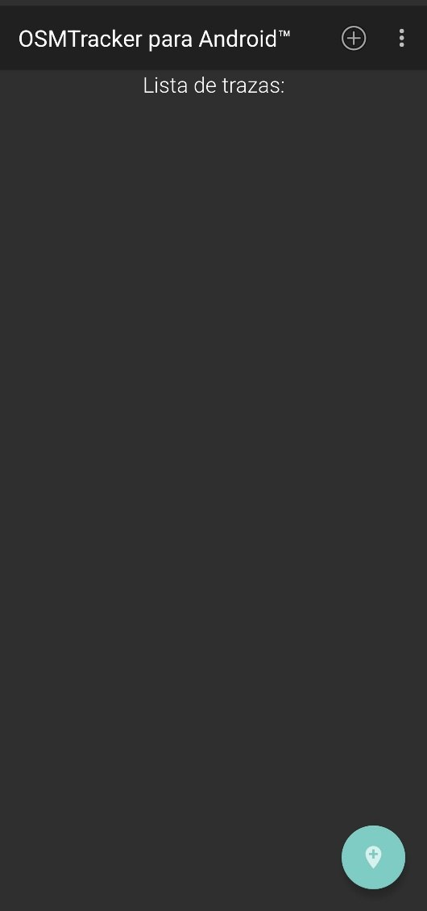

**Paso 2.** Baja hasta **Disposición de los botones** (en la sección «Interfaz de usuario») y tócala.

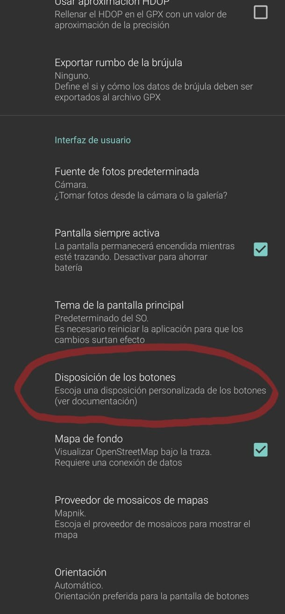

**Paso 3.** Se abrirá la lista de disposiciones instaladas. Si aún no has descargado ninguna, solo verás la predeterminada. Toca el símbolo **+** de la parte superior para ver las disposiciones disponibles para descargar.

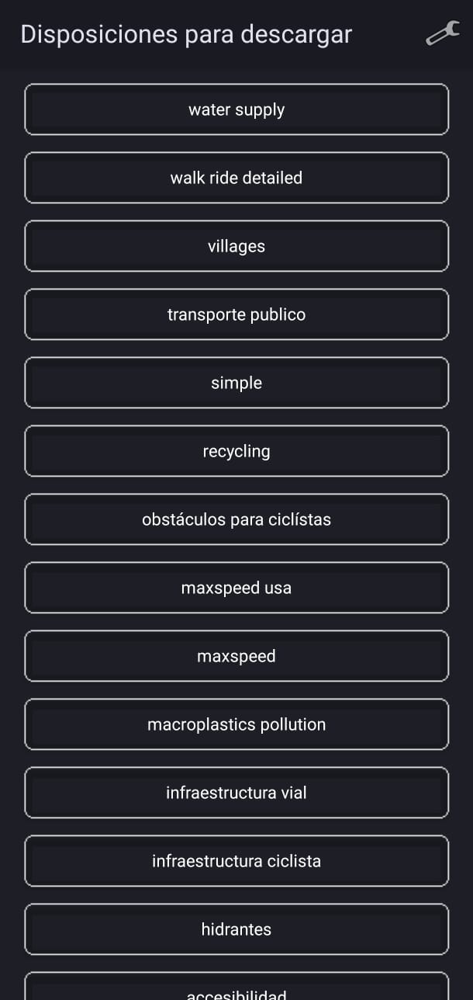

**Paso 4.** Nuestra disposición no aparece en esa lista, así que hay que indicarle a la aplicación dónde buscarla. Toca la **llave inglesa** de arriba a la derecha y elige **Personalizado**.

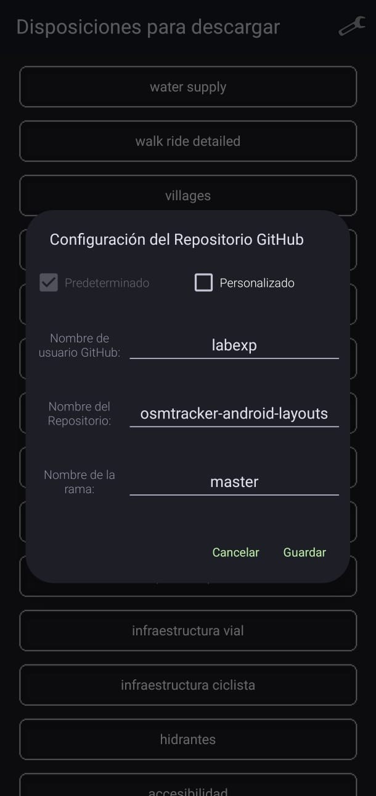

**Paso 5.** Llena el formulario con estos datos y toca **Guardar**:

| Campo | Qué escribir |
|---|---|
| Nombre de usuario GitHub | `JotaRdgz06` |
| Nombre del repositorio | `mapeoOSM` |
| Nombre de la rama | `main` |

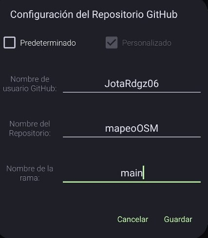

> Estos son los datos de *nuestra* disposición. Si algún día quieres usar la de otro grupo, el procedimiento es igual: se cambian el usuario y el repositorio que contienen la disposición.

**Paso 6.** Aparecerán las disposiciones disponibles en ese repositorio. Toca la que quieres (`elementos_peatonales`), lee la descripción y presiona **Descargar**.

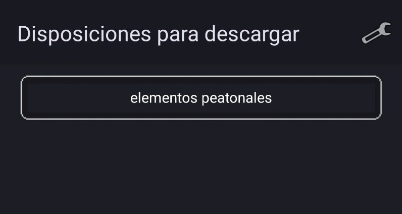

**Paso 7.** Vuelve a **Disposición de los botones**: la nueva aparecerá en la sección **Descargadas**. Selecciónala y listo. En tu próximo mapeo verás los botones del proyecto.

## 3. Mapear en el campo

**Empezar.** Si es la primera vez que usas OSMTracker, verás la pantalla vacía de la lista de trazas:

Para empezar a mapear toca el botón **+** de la parte superior derecha, junto a los tres puntos, o el **botón celeste** de abajo a la derecha. Cualquiera de los dos inicia el mapeo de inmediato.

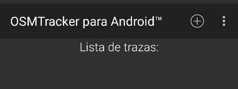 &nbsp; 

**Los botones.** Verás una pantalla como esta (cambia según la disposición que uses):

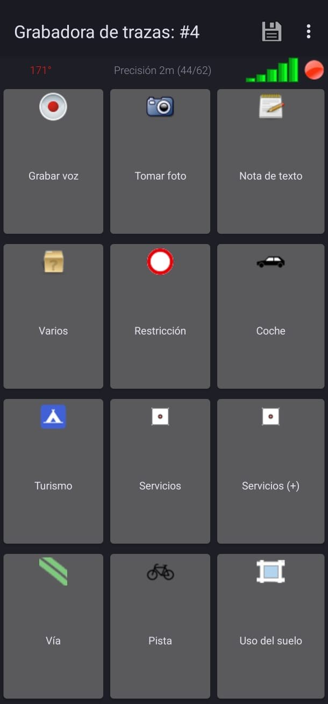

Desde este momento ya puedes caminar: la aplicación va dibujando tu recorrido (la **traza**). Para verlo, toca los tres puntos de arriba a la derecha y elige **Mostrar la traza**; para volver a los botones, regresa con la flecha.

**Marcar un elemento (punto).** Camina hasta el elemento, identifica su botón y tócalo. Por ejemplo, para una parada de bus: ve a la parada y toca el botón correspondiente. Aparecerá un aviso abajo confirmando que se registró. Si miras la traza, verás una estrella donde marcaste.

En la disposición del proyecto los botones son:

| Botón | Para qué sirve | Color en el mapa |
|---|---|---|
| Acera | Tramo de acera | Azul |
| Fin de la acera | Donde la acera termina o se interrumpe | Azul |
| Paso peatonal | Cruce peatonal | Rojo |
| Semáforo | Semáforo | Rojo |
| Señal de tránsito | Señales de alto y otras | Rojo |
| Reductor de velocidad | Lomo o resalto | Rojo |
| Hidrante | Hidrante | Naranja |
| Parque | Parque | Verde |
| Cancha de fútbol | Cancha | Verde |
| Parada bus | Parada de autobús | Morado |
| Recorrido bus | Ruta de autobús | Morado |

**Fotos, audios y notas.** Para guardar detalles de lo que mapeas, usa:

- **Tomar foto**: guarda una imagen. En este proyecto es lo más importante: aparecerá en el mapa junto al punto.
- **Grabar voz**: guarda una nota de audio.
- **Nota de texto**: guarda un comentario escrito.

**Terminar.** Al acabar el recorrido, toca el botón de la parte superior derecha (junto a los tres puntos) para guardar el mapeo.

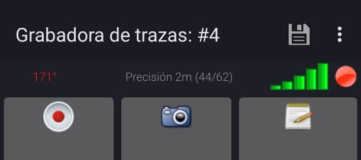

Tu recorrido ya aparece en la lista de trazas. Desde ahí puedes exportarlo como archivo `.gpx` (por ejemplo, para usarlo en OpenStreetMap) o subirlo directamente a nuestro repositorio, como se explica a continuación.

## 4. Subir las trazas al repositorio

Al subir una traza, el mapa se actualiza automáticamente con tus puntos, fotos y recorrido.

**Antes de empezar:**

1. Necesitas una cuenta gratuita de GitHub ([github.com](https://github.com)).
2. Pásale tu nombre de usuario de GitHub a `JotaRdgz06` para que te agregue como **colaborador** del repositorio. Recibirás una invitación por correo o en GitHub: **acéptala**. Sin este paso, la subida será rechazada.

**Paso 1.** Después de mapear, mantén presionada la traza que quieres subir y toca **Subir a GitHub**.

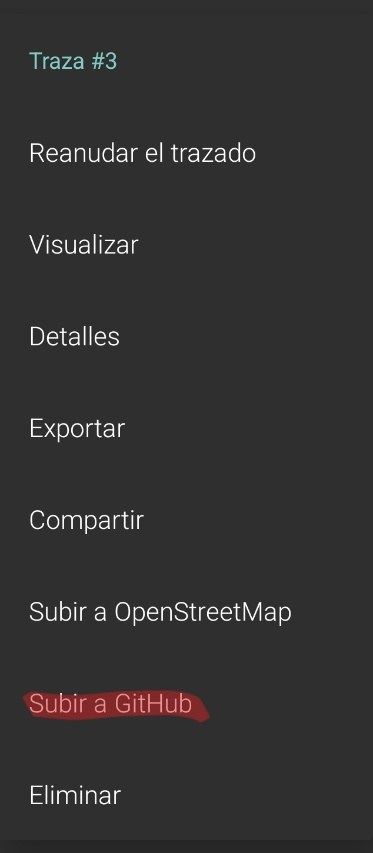

**Paso 2.** La primera vez te pedirá dos datos (después quedan guardados):

- **Nombre de usuario GitHub**: tu propio usuario.
- **Token de GitHub**: una especie de contraseña que permite a la aplicación subir archivos en tu nombre. Si no tienes uno, toca **Obtener token** y sigue las instrucciones de la pantalla (debe ser un token «classic» con el permiso `repo`).

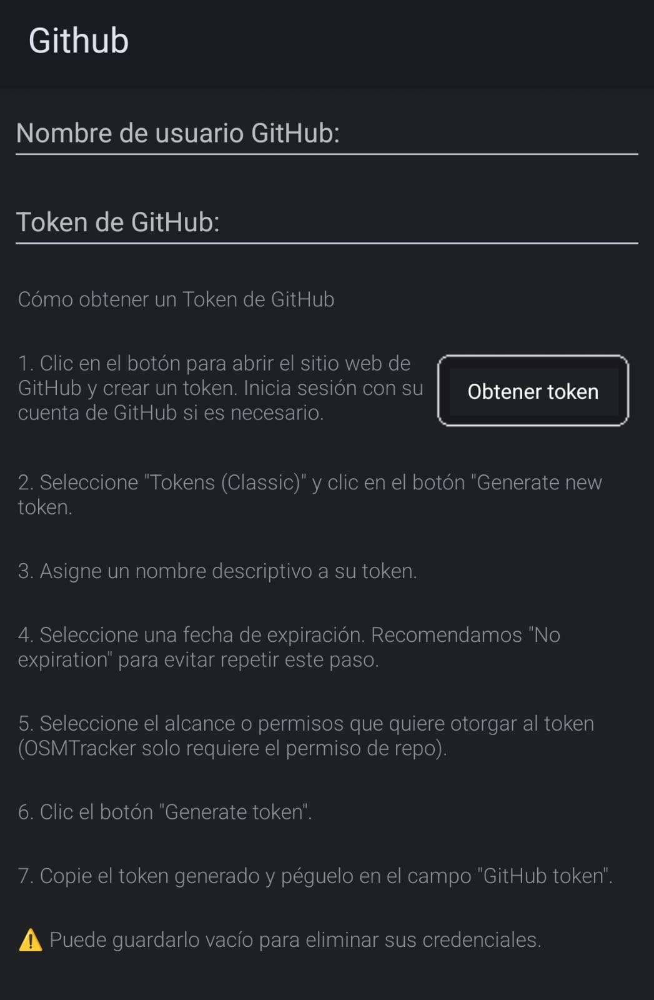

> **Importante:** tu token es privado. No lo compartas ni lo publiques en ningún lugar.

**Paso 3.** Si todo sale bien, los datos se guardan. Vuelve a tocar **Subir a GitHub** y aparecerá esta pantalla:

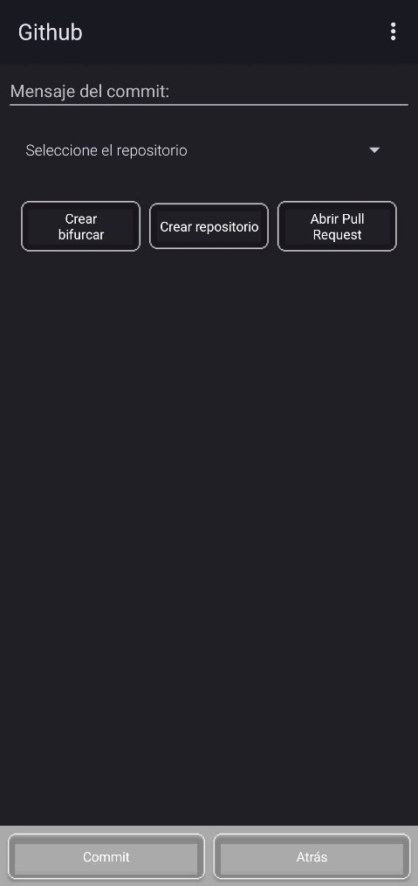

1. En **Mensaje del commit**, escribe una frase corta sobre lo que mapeaste (por ejemplo: «Aceras de la calle principal»).
2. En **Seleccione el repositorio**, elige **Mapeo_tematico**.
3. Toca **Commit**.

El archivo se sube a GitHub y lo verás en la página del repositorio casi de inmediato. Tus datos aparecerán en el mapa unos minutos después.

## 5. Consultar el mapa

Abre este enlace desde cualquier navegador, en el celular o en la computadora:

**https://jotardgz06.github.io/Mapeo_tematico/**

En el mapa:

- Cada punto tiene el color de su categoría: **aceras** (azul), **cruces y tránsito** (rojo), **seguridad** (naranja), **espacios de permanencia** (verde) y **transporte público** (morado).
- Al tocar un punto aparecen su tipo, la fecha y las fotografías.
- Las líneas son los recorridos que se caminaron.
- Un filtro temporal permite ver solo los recorridos a partir de cierta fecha, o mostrarlos todos de nuevo.

Si acabas de subir una traza y no la ves, espera unos minutos y recarga la página con **Ctrl + F5** (en el celular, cierra y abre de nuevo el navegador).

## 6. Enlaces del proyecto

- Mapa: https://jotardgz06.github.io/Mapeo_tematico/
- Disposición de botones: https://github.com/JotaRdgz06/mapeoOSM
- Este repositorio: https://github.com/JotaRdgz06/Mapeo_tematico

### Cómo funciona por dentro

1. OSMTracker sube la traza (en un archivo ZIP con su GPX y fotos) a este repositorio.
2. Una acción de GitHub (`.github/workflows/procesar.yml`) se ejecuta con cada subida.
3. El script `procesar_gpx.py` descomprime los archivos nuevos y genera `datos.geojson`, con los puntos, las trazas, las fechas y las fotos.
4. La página `index.html` (con los scripts de la carpeta `js/`) lee ese archivo y dibuja el mapa en GitHub Pages.
